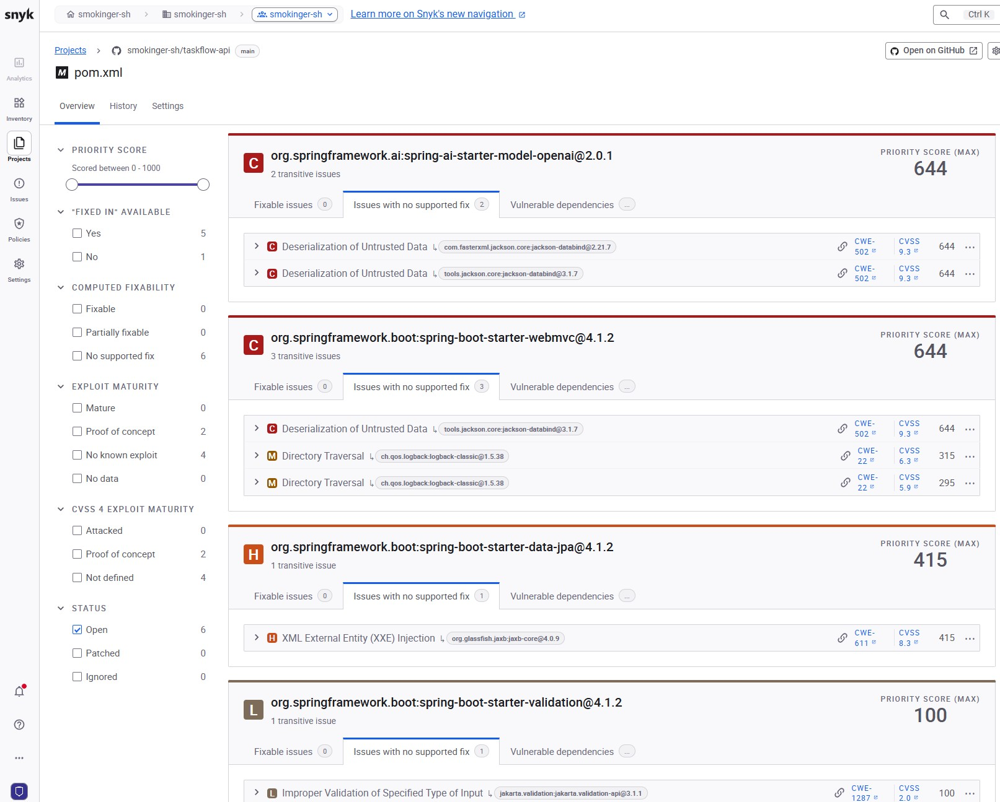
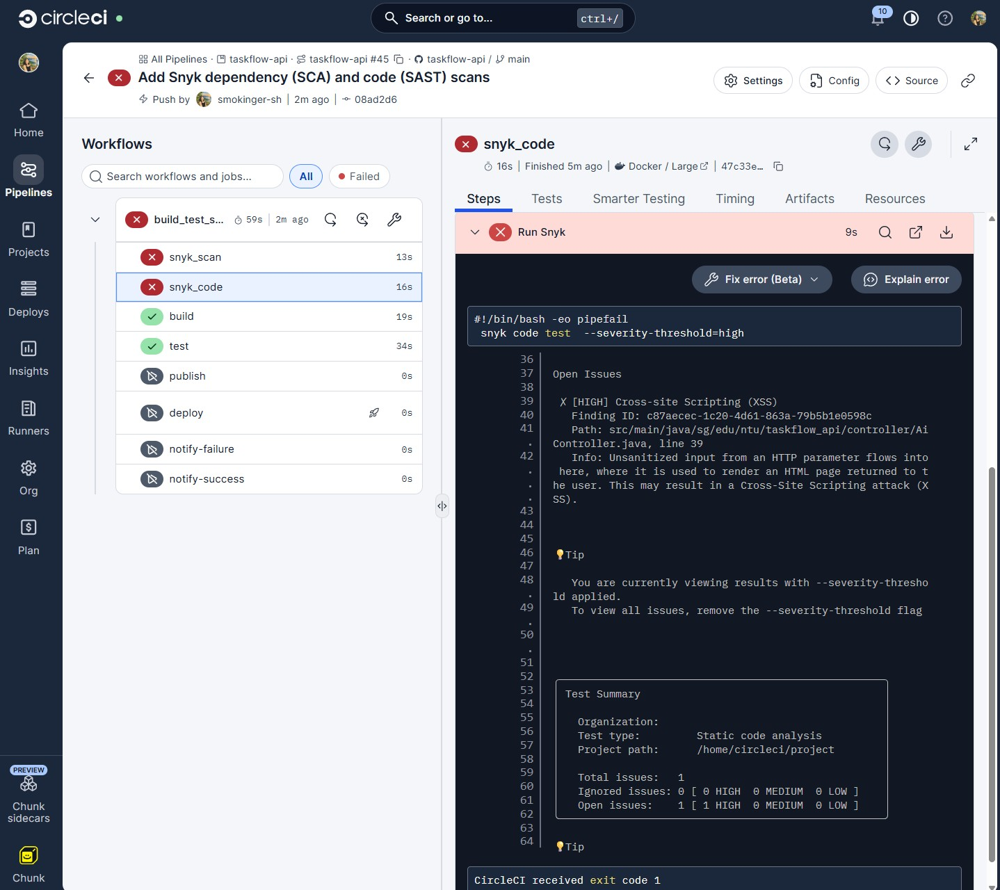

# 🚀 TaskFlow API


## 📌 Table of Contents
- [Overview](#-overview)
- [Getting Started](#-getting-started)
- [API Documentation](#-api-documentation)
- [Configuration](#-configuration)
- [Frontend Webapp](#-frontend-webapp)
- [Screenshots](#-screenshots)
- [Gratitude](#-gratitude)
- [License](#-license)
- [Author](#-author)

---

## 📖 Overview
### The Challenge: 
The company lacks a centralized task management system for staff to log and manage their requests. There is also no tracking mechanism to monitor request statuses, making it difficult for staff to track progress, follow up on outstanding tasks, and ensure requests are completed in a timely manner.

### The Solution:
- ✅ Allow creating of staff through API. 
- ✅ Each staff is allowed to raise multiple requests

---

## 🚀 Getting Started

### Prerequisites

Ensure you have installed:

- Java 17 or later
- Maven
- PostgreSQL
- Git

### 1. Clone the repository

```bash
git clone https://github.com/yourusername/your-project.git
```

### 2. Navigate to the project directory

```bash
cd your-project
```

### 3. Configure the database

Create a PostgreSQL database:

```sql
CREATE DATABASE my_database;
```

### 4. Configure application properties

Update `src/main/resources/application.properties`:

```properties
spring.datasource.url=jdbc:postgresql://localhost:5432/my_database
spring.datasource.username=${DB_USERNAME}
spring.datasource.password=${DB_PASSWORD}

spring.jpa.hibernate.ddl-auto=update
spring.jpa.show-sql=true
```

Set your database credentials using environment variables.

### 5. Run the application

```bash
mvn clean spring-boot:run
```

The application will start at:

http://localhost:8080

---

## 📡 API Documentation


### Base URL 
| No | Location | Path | 
|-----------|-----------|-----------|
| 1     |      Local     |    http://localhost:8080/api/staff |
| 2     |     Local      |     http://localhost:8080/api/tasks  |
| 3     |      Server     |    https://taskflowapi-v2-0-0-1.onrender.com/staff |
| 4     |     Server      |     https://taskflowapi-v2-0-0-1.onrender.com/tasks  |


| No | Method | Path | What it does |
|-----------|-----------|-----------|-----------|
| 1     |      POST     |    /staff       |      Add Staff     |
| 2     |     GET      |      /staff     |     Display all staff      |
| 3     |      POST     |       /tasks    |      Add task tagged to staff     |
| 4     |       GET    |     /tasks      |    Display all tasks       |
| 5     |       GET    |    /tasks/{{id}}       |     Search for specific task id      |
| 6     |       PUT    |     /tasks/{{id}}      |      Update task by task id     |
| 7     |     DELETE      |      /tasks/{{id}}     |       Delete task by task id    |
| 8     |      PUT     |    /tasks{{id}}/complete       |     Update task status as completed      |
| 9     |      GET     |      /support?message=how do i install microsoft word     |     AI Support Tool for Internal Staff      |

### Example Request

**POST** `/staff`

```json
  {

  "name": "Mary",
  "email": "mary@avengers.com",
  "department": "MARKETING",
  "position": "Executive"
  
  }
```

**POST** `/tasks`

```json
  {

  "taskName": "Prepare report",
  "description": "Prepare the monthly report",
  "status": "PENDING",
  "staff": {"id": 1}
  
  }
```

---

## ⚙️ Configuration

| Variable | Description |
|---|---|
| `DB_USERNAME` | PostgreSQL username |
| `DB_PASSWORD` | PostgreSQL password |
| `DB_URL` | PostgreSQL connection URL |

**Security note:** Never commit database passwords, API keys, or other secrets to GitHub.

---
## 🌐 Frontend Webapp
Frontend inteface is built using React and hosted in Netlify

| URL |
|---|
| [Github - Taskflow Frontend](https://github.com/smokinger-sh/taskflow-frontend "Github - Taskflow Frontend") |
| [Taskflow WebApp](https://taskflowapi-sh.netlify.app/ "TaskFlow WebApp") |

### Key Features
| No | Pages | Features | 
|-----------|-----------|-----------|
| 1     |      Dashboard & Tasks     | Summary of the status of each status and search tasks |
| 2     |     Add Task      |     Add Request  |
| 3     |      Staff     |    Search and view staff |
| 4     |     Register Staff      |     Register Staff  |
| 5     |     AI Support      |     Chatbot to encourage staff self-help before raising request  |


### Issues and Resolutions

I came across issues when hosting in Netlify. It was deployed successfully, however, on the webapp it shows an error message: **Cannot reach the server. It may be waking up (free hosting) or blocked by CORS. Please try again in a moment.**

#### I have utilised Copilot to help me understand the issue:
> [!Tip]
> “The frontend is hosted on Netlify, and the backend API is hosted on Render. Because they use different domains, the browser requires the backend to explicitly allow requests from the frontend. This is called CORS.

> We tested the API and it returned HTTP 200, meaning it was reachable. However, its responses were missing the CORS permission headers, so the browser blocked the frontend from reading them.

> The fix is to configure CORS in the Spring Boot backend to allow our Netlify website, then redeploy the backend.”

#### Copilot suggested fix which I have implemented in Springboot:
Under ```/taskflow_api/config``` folder, add ```CorsConfig.java``` and ```SecurityConfig.jaa```.
In pom.xml, import ```Springboot Starter Security```.


---
## 📸 Screenshots

Add screenshots of your application, API responses, or UI here.

### DBeaver

#### Local Staff Database 


#### Local Tasks Database 


### CircleCI

#### Pre-requisite
Run the following script locally in VSCode terminal to ensure TaskControllerTest.java is sucessful before deploying into CircleCI
```bash
mvn test -Dtest=TaskControllerTest.java
```
The screenshots below show success in deployment in CircleCI and webhook to Discord
- ✅ Build
- ✅ Test
- ✅ Publish
- ✅ Deploy
- ✅ Notification to Discord

#### Circle CI Screenshot


#### Discord Notification


### Git Actions

The screenshot below shows success Build-Test-Publish Workflow


### Docker Desktop - Local

Run the following code in VSCode terminal to build image and create container on local
```bash
docker compose up -d --build
docker build -t smokinger/taskflow-api:v1.0.0
```

#### Docker Desktop - App and DB in Container


### Docker Hub - Server

Run the following code in VSCode terminal to build and push image in server
```bash
docker login
docker build --platform linux/amd64 -t smokinger/taskflowapi:v1.0.0 .
docker push smokinger/taskflowapi:v1.0.0
```
#### Docker Compose - with versionings


### Render
#### Render - App and DB in Production


### Security

I have scanned smokinger-sh/taskflow-api with Snyk application, here are the top 4 Issues on POM.xml


When I add Synk Scan codes into .circleci/config.yml and run with CircleCI, I come across a High severity security issue with AiController.java



Claude suggested that the endpoint returns the LLM output as a raw String, which is derived from user input, so Snyk treats it as reflected HTML. Claude suggest to tweak the code to return JSON instead. I did not implement this due to time constraint, and will take this into consideration in the upcoming Captstone Project. 

```java
import java.util.Map;
import org.springframework.http.MediaType;

@GetMapping(value = "/support", produces = MediaType.APPLICATION_JSON_VALUE)
public Map<String, String> support(@RequestParam String message) {
    String reply = chatClient.prompt()
            .system("You are a friendly and professional task support assistant for a Fashion company. " +
                    "You help users with questions on their various technical, administrative tasks " +
                    "Keep your answers concise and practical. " +
                    "Always provide step-by-step instructions when explaining tasks. " +
                    "If a question is not related to tasks, politely redirect the user.")
            .user(message)
            .call()
            .content();
    return Map.of("reply", reply);
}

```


---
## 🤝 Gratitude

Thank you for the patience and coaching 

- 👩‍💻 Daniel
- 👩‍💻 Jesstern
- 👩‍💻 Sanjela

---

## 📄 License

This project is licensed under the MIT License.

---

## 👩‍💻 Author

**Siew Hoon**

- LinkedIn: [Your LinkedIn](https://linkedin.com/in/siewhoon)
- GitHub: [Your GitHub](https://github.com/smokinger-sh)
