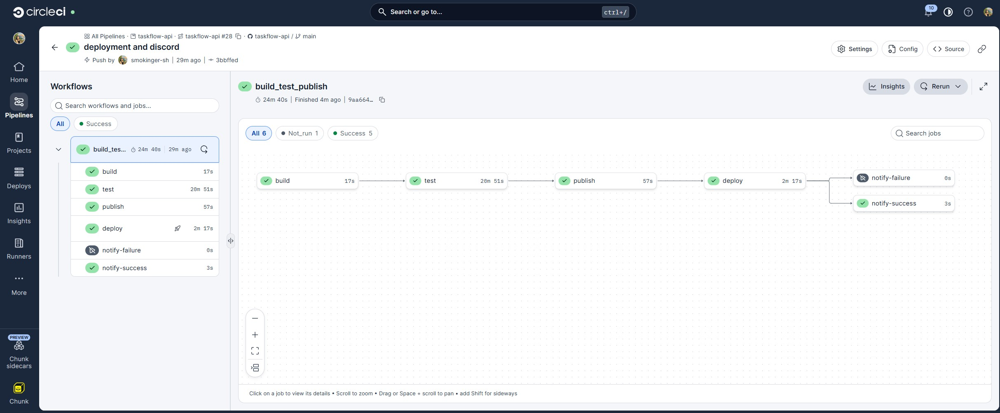
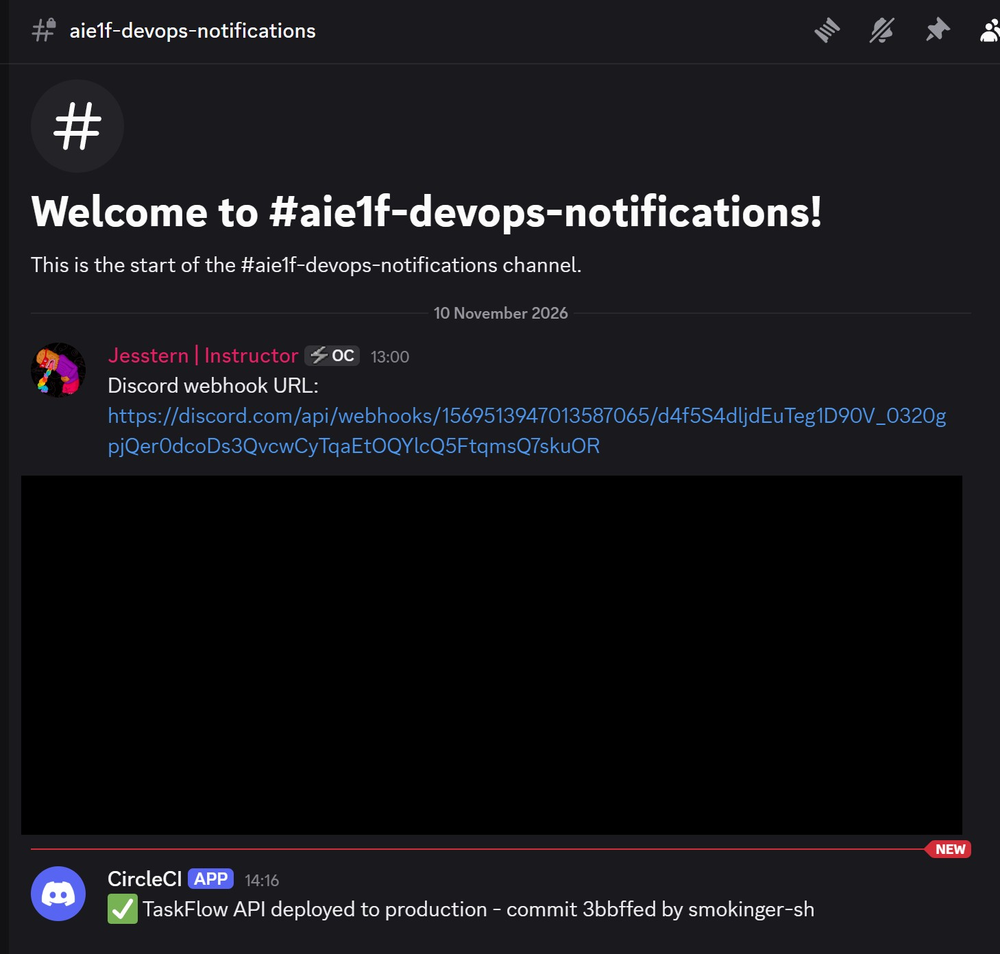
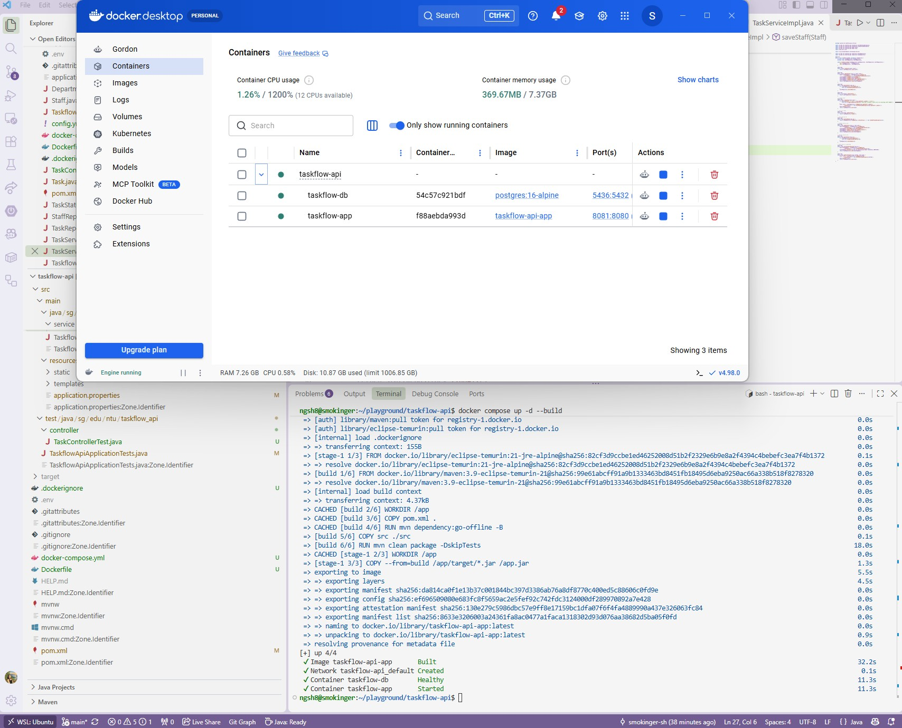
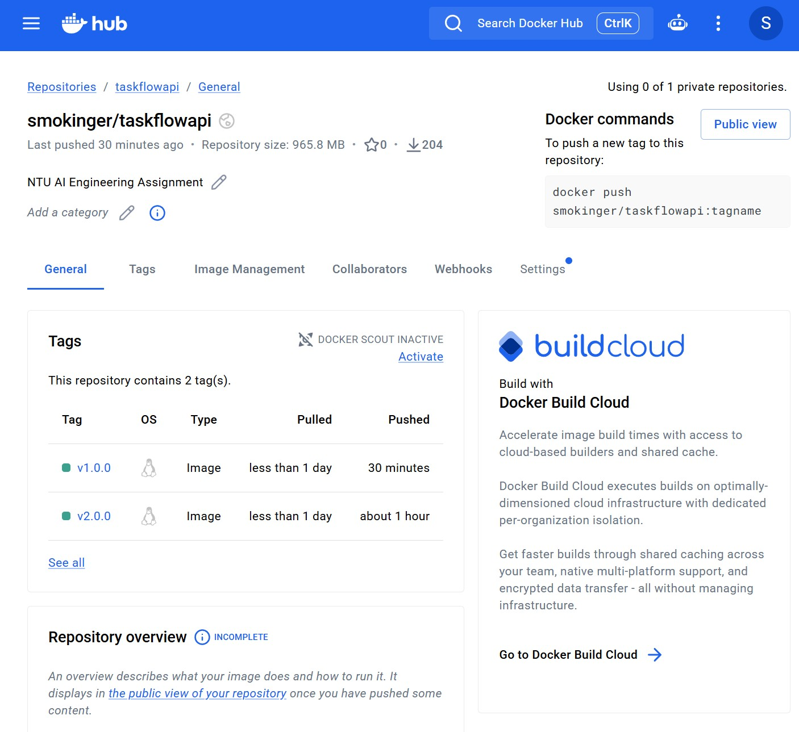
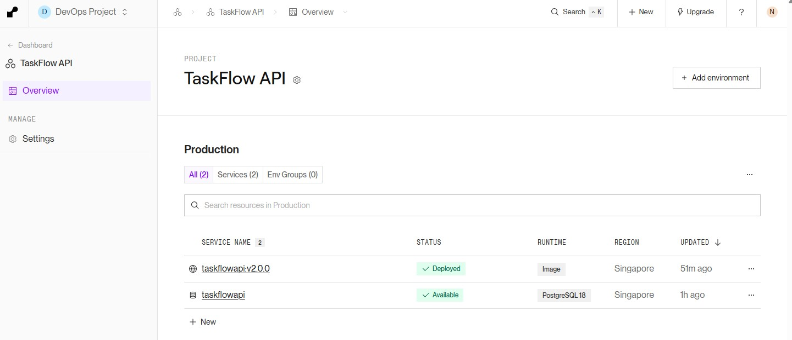

# 🚀 TaskFlow API


## 📌 Table of Contents
- [Overview](#-overview)
- [Getting Started](#-getting-started)
- [API Documentation](#-api-documentation)
- [Configuration](#-configuration)
- [Screenshots](#-screenshots)
- [Gratitude](#-gratitude)
- [License](#-license)

---

## 📖 Overview
### The Challenge: 
The company lacks a centralized task management system for staff to log and manage their requests. There is also no tracking mechanism to monitor request statuses, making it difficult for staff to track progress, follow up on outstanding tasks, and ensure requests are completed in a timely manner.

### The Solution:
- ✅ Allow creating of staff through API. 
- ✅ Each staff is allowed to raise multiple requests

---

## 🚀 Getting Started

### Prerequisites

Ensure you have installed:

- Java 17 or later
- Maven
- PostgreSQL
- Git

### 1. Clone the repository

```bash
git clone https://github.com/yourusername/your-project.git
```

### 2. Navigate to the project directory

```bash
cd your-project
```

### 3. Configure the database

Create a PostgreSQL database:

```sql
CREATE DATABASE my_database;
```

### 4. Configure application properties

Update `src/main/resources/application.properties`:

```properties
spring.datasource.url=jdbc:postgresql://localhost:5432/my_database
spring.datasource.username=${DB_USERNAME}
spring.datasource.password=${DB_PASSWORD}

spring.jpa.hibernate.ddl-auto=update
spring.jpa.show-sql=true
```

Set your database credentials using environment variables.

### 5. Run the application

```bash
mvn clean spring-boot:run
```

The application will start at:

http://localhost:8080

---

## 📡 API Documentation


### Base URL 
| No | Location | Path | 
|-----------|-----------|-----------|
| 1     |      Local     |    http://localhost:8080/api/staff |
| 2     |     Local      |     http://localhost:8080/api/tasks  |
| 3     |      Server     |    https://taskflowapi-v2-0-0-1.onrender.com/staff |
| 4     |     Server      |     https://taskflowapi-v2-0-0-1.onrender.com/tasks  |


| No | Method | Path | What it does |
|-----------|-----------|-----------|-----------|
| 1     |      POST     |    /staff       |      Add Staff     |
| 2     |     GET      |      /staff     |     Display all staff      |
| 3     |      POST     |       /tasks    |      Add task tagged to staff     |
| 4     |       GET    |     /tasks      |    Display all tasks       |
| 5     |       GET    |    /tasks/{{id}}       |     Search for specific task id      |
| 6     |       PUT    |     /tasks/{{id}}      |      Update task by task id     |
| 7     |     DELETE      |      /tasks/{{id}}     |       Delete task by task id    |
| 8     |      PUT     |    /tasks{{id}}/complete       |     Update task status as completed      |
| 9     |      GET     |      /support?message=how do i install microsoft word     |     AI Support Tool for Internal Staff      |

### Example Request

**POST** `/staff`

```json
  {

  "name": "Mary",
  "email": "mary@avengers.com",
  "department": "MARKETING",
  "position": "Executive"
  
  }
```

**POST** `/tasks`

```json
  {

  "taskName": "Prepare report",
  "description": "Prepare the monthly report",
  "status": "PENDING",
  "staff": {"id": 1}
  
  }
```

---

## ⚙️ Configuration

| Variable | Description |
|---|---|
| `DB_USERNAME` | PostgreSQL username |
| `DB_PASSWORD` | PostgreSQL password |
| `DB_URL` | PostgreSQL connection URL |

**Security note:** Never commit database passwords, API keys, or other secrets to GitHub.

---

## 📸 Screenshots

Add screenshots of your application, API responses, or UI here.

### DBeaver

#### Local Staff Database 


#### Local Tasks Database 


### CircleCI

#### Pre-requisite
Run the following script locally in VSCode terminal to ensure TaskControllerTest.java is sucessful before deploying into CircleCI
```bash
mvn test -Dtest=TaskControllerTest.java
```
The screenshots below show success in deployment in CircleCI and webhook to Discord
- ✅ Build
- ✅ Test
- ✅ Publish
- ✅ Deploy
- ✅ Notification to Discord

#### Circle CI Screenshot


#### Discord Notification


### Git Actions

The screenshot below shows success Build-Test-Publish Workflow


### Docker Desktop - Local

Run the following code in VSCode terminal to build image and create container on local
```bash
docker compose up -d --build
docker build -t smokinger/taskflow-api:v1.0.0
```

#### Docker Desktop - App and DB in Container


### Docker Hub - Server

Run the following code in VSCode terminal to build and push image in server
```bash
docker login
docker build --platform linux/amd64 -t smokinger/taskflowapi:v1.0.0 .
docker push smokinger/taskflowapi:v1.0.0
```
#### Docker Compose - with versionings


### Render
#### Render - App and DB in Production




---
## 🤝 Gratitude

Thank you for the patience and coaching 

- 👩‍💻 Daniel
- 👩‍💻 Jesstern
- 👩‍💻 Sanjela

---

## 📄 License

This project is licensed under the MIT License.

---

## 👩‍💻 Author

**Siew Hoon**

- LinkedIn: [Your LinkedIn](https://linkedin.com/in/siewhoon)
- GitHub: [Your GitHub](https://github.com/smokinger-sh)
